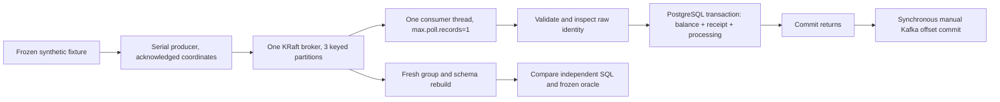

# Local event flow and failure boundaries

There is no atomic transaction across PostgreSQL and Kafka. Before-commit SIGKILL rolls
back staged SQL; postcommit/pre-ack SIGKILL retains SQL and causes redelivery. Accepted
receipts and unique log coordinates make the repeated delivery harmless to effects.
Acknowledgement failure stops the consumer; a real network acknowledgement outage is
not part of the measured process-crash study.

Only transient database failures retry: three total attempts per record/process with
100 ms then 500 ms backoff. A persistent failure or unexpected error stops without
acknowledgement. An explicit fault-free restart is distinct from an infinite retry loop.
Database connections, SQL, broker requests, startup, barriers and catch-up have finite
timeouts. Unexpected shutdowns never turn into successful/skipped evidence.

Each run has its own labelled Compose project, topics, groups, schemas and two named
volumes, with no published host ports. App containers are limited to 384 MiB, PostgreSQL
512 MiB and Kafka 1536 MiB. Integration containers bind random loopback ports and run
serially. The build container is limited to 2 GiB and two CPUs. No other project's
containers, volumes, source or ports are controlled.

Projection metadata binds source topic, group, seed and full fixture hash. Rebuild needs
a fresh schema/group and unchanged retained beginning/end offsets. Preflight refusal
creates no target; if the source changes after creation, the failed target is retained.
The original remains unchanged. This detects boundary changes, not malicious mutation
of retained log bytes. Retention is seven days with deletion policy, not compaction.

Acceptance uses the packaged image identified by clean Git revision, actual image ID
and the SHA256 of the JAR inside it. Independent single-statement PostgreSQL readback,
actual group offsets, matching flushed fault markers, verified KILL/exit137/OOMfalse and
restart logs support the claims. Injected database exceptions are reported separately.
The final rebuild uses another schema/group; resetting offsets on an existing receipt
table would not demonstrate a full rebuild.
